# Simulazione di una rete SDN e mitigazione di attacchi DoS tramite controller Ryu

**Autore:** Antonio D'Angiolella  
**Matricola:** DE900018023


## Indice

1. [Introduzione](#1-introduzione)
2. [Descrizione del progetto](#2-descrizione-del-progetto)
3. [Topologia di rete](#3-topologia-di-rete)
4. [Installazione controller Ryu](#4-installazione-controller-ryu)
5. [Script del controller Ryu](#5-script-del-controller-ryu)
    - [5.1 Fase di Init](#51-fase-di-init)
    - [5.2 Fase di connessione e Table-Miss](#52-fase-di-connessione-e-table-miss)
    - [5.3 Funzione add_flow](#53-funzione-add_flow)
    - [5.4 Intercettazione e Mitigazione](#54-intercettazione-e-mitigazione)
    - [5.5 MAC Learning e inoltro legittimo](#55-mac-learning-e-inoltro-legittimo)
6. [Simulazione attacco e mitigazione](#6-simulazione-attacco-e-mitigazione)
    - [6.1 Attacchi DoS](#61-attacchi-dos)
    - [6.2 Esecuzione del test](#62-esecuzione-del-test)
    - [6.3 Rilevazione dell'attacco](#63-rilevazione-dellattacco)
    - [6.4 Isolamento dell'attaccante e ripresa del traffico](#64-isolamento-dellattaccante-e-ripresa-del-traffico)
7. [Limiti dell'implementazione e sviluppi futuri](#7-limiti-dellimplementazione-e-sviluppi-futuri)

---

## 1. Introduzione

Negli ultimi anni l'espansione di internet e delle reti ha creato sfide cruciali in termini di sicurezza. Ad oggi sulla rete è possibile fare di tutto: se da un lato questo permette di velocizzare i processi e superare la burocrazia, dall'altro l'iperdigitalizzazione espone a nuovi rischi che, se non affrontati a dovere, possono causare danni a utenti, aziende o addirittura nazioni intere. Le reti sono di vitale importanza per i cittadini, per le grandi organizzazioni e per gli apparati governativi, con volumi di traffico globale in ininterrotto aumento. Le sfide tecnologiche conseguenti sono molteplici e spaziano dalla velocità di trasmissione all'affidabilità, includendo obiettivi chiave come la Quality of Service (QoS), la persistenza dei dati e, non ultima, la loro sicurezza.

Le reti moderne hanno quindi cambiato paradigma, passando da un'infrastruttura formata da dispositivi con funzioni rigidamente integrate alle reti **SDN (Software-Defined Networking)**. Questo approccio permette di separare fisicamente il **piano di controllo** decisionale dal **piano dati** dedicato all'inoltro dei pacchetti. Invece di affidarsi all'intelligenza distribuita nei singoli router o switch tradizionali, l'SDN centralizza l'intera logica in un componente software esterno chiamato *controller*, il quale comunica con l'hardware sottostante tramite protocolli standard come OpenFlow. Questa separazione fornisce vantaggi fondamentali in termini di gestione, programmabilità e difesa dell'infrastruttura.

## 2. Descrizione del progetto

Il presente progetto si pone l'obiettivo di esplorare le potenzialità delle reti SDN applicate alla sicurezza informatica, concentrandosi sul rilevamento e sulla mitigazione degli attacchi **Denial of Service (DoS)**. Attraverso l'utilizzo dell'emulatore **Mininet** e lo sviluppo di un'applicazione dedicata sul controller **Ryu**, verrà illustrato come il piano di controllo possa monitorare attivamente il traffico di rete e rilevare anomalie volumetriche. In caso di attacco, il sistema interviene autonomamente sfruttando il protocollo OpenFlow per istruire il piano dati, isolando istantaneamente l'indirizzo IP della fonte malevola e garantendo la totale continuità del servizio per gli utenti legittimi.

**Attacco DoS.** Si definisce attacco DoS una tipologia di attacco che punta a saturare le risorse di un server tramite l'utilizzo di semplici pacchetti di dati. L'attaccante genera un gran numero di richieste di connessione o di pacchetti malevoli ad altissima velocità; se l'infrastruttura non è in grado di filtrare tempestivamente questo traffico anomalo, le risorse si esauriscono, rendendo la macchina attaccata inutilizzabile e isolandola dagli altri nodi. Ciò si può tradurre in una mancanza di servizi per i client legittimi della rete.

**OpenFlow.** È lo standard di comunicazione fondamentale nelle architetture SDN, progettato per permettere al piano di controllo centralizzato di dialogare direttamente con il piano dati dei dispositivi di rete. Funziona come un'interfaccia che consente al controller di programmare dinamicamente le tabelle di flusso (*flow table*) degli switch fisici o virtuali, dettando regole hardware su come i pacchetti debbano essere instradati o, in caso di attacco, scartati.

**Ryu.** È un framework open source basato su Python che agisce come sistema operativo centrale (il "cervello") della rete SDN. Fornisce librerie e API native per gestire i protocolli di rete e ascoltare eventi asincroni, permettendo agli sviluppatori di creare applicazioni logiche personalizzate che analizzano il traffico e inviano istruzioni decisionali agli switch sottostanti sfruttando il protocollo OpenFlow.

## 3. Topologia di rete

La topologia della rete viene emulata tramite lo script `topology.py` in Mininet. Lo script implementa un'architettura a **stella** progettata specificamente per testare le logiche di difesa SDN.

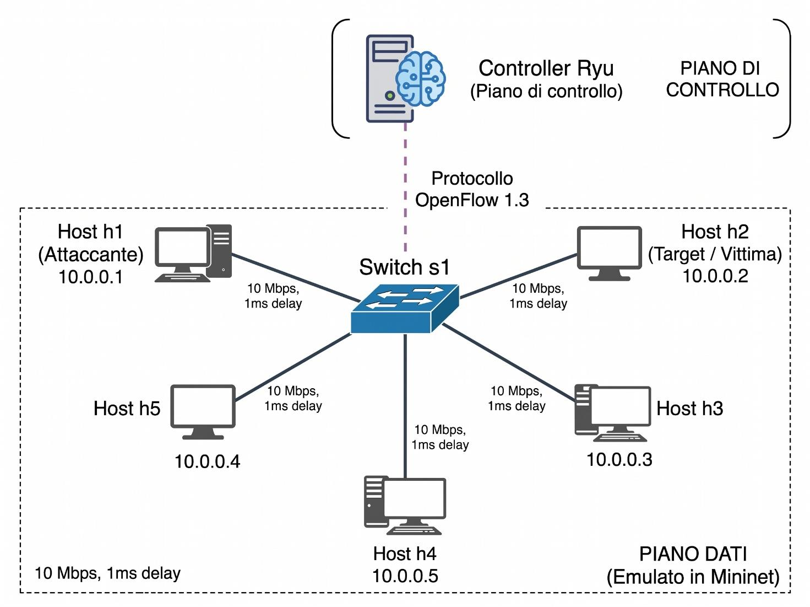

Nella topologia appena vista i nodi sono tutti connessi allo switch `s1` sul quale andremo ad installare il controller Ryu che fungerà da cervello della rete. È stata scelta una topologia con dei link molto semplici: questo permette un controllo più semplice con una netta separazione tra i vari livelli della rete. Non è il massimo dell'affidabilità, in quanto se il link che collega uno dei nodi allo switch si dovesse guastare, questi rimarrebbe totalmente isolato dalla rete.

| Nodo | Ruolo | Indirizzo IP |
|------|-------|--------------|
| `h1` | Attaccante | 10.0.0.1 |
| `h2` | Target / Vittima | 10.0.0.2 |
| `h3` | Host legittimo | 10.0.0.3 |
| `h4` | Host legittimo | 10.0.0.4 |
| `h5` | Host legittimo | 10.0.0.5 |

Tutti i link host–switch sono impostati a 10 Mbps con 1 ms di delay. La comunicazione tra controller e switch avviene tramite OpenFlow 1.3.

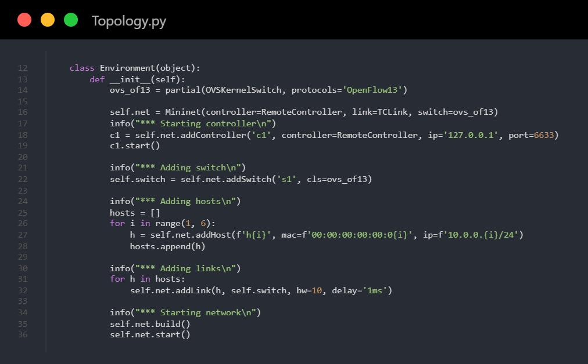

Nello script possiamo notare la definizione della classe `Environment` in cui vengono definiti i vari nodi della rete. `s1` è lo switch a cui viene assegnato il protocollo OpenFlow 1.3 tramite l'oggetto `ovs_of13`.

Gli host, tra cui attaccante e bersaglio, sono stati aggiunti tramite un ciclo specificando nome, indirizzo MAC e indirizzo IP; ad ogni host viene assegnato un link allo switch. I link sono impostati ad una velocità di 10 Mbps e con un ritardo di 1 ms.

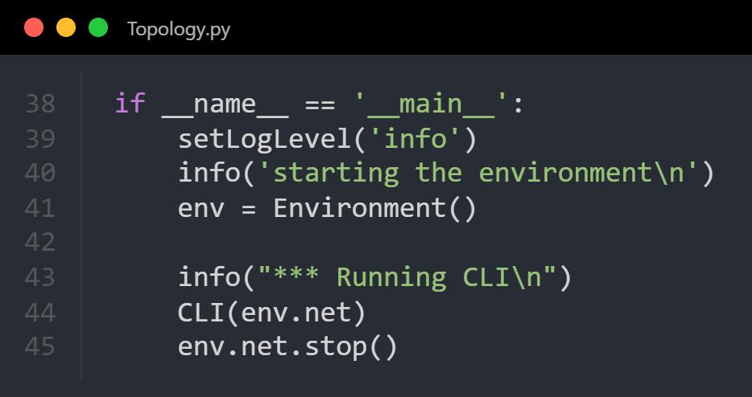

La sezione principale dello script gestisce l'avvio e la configurazione dell'ambiente di simulazione: imposta il livello di log a `info`, stampa un messaggio di avvio e istanzia l'oggetto `Environment`. Infine, avvia la riga di comando interattiva (CLI) sulla rete creata per consentire i test e la generazione del traffico, provvedendo alla chiusura e alla pulizia finale delle risorse tramite `env.net.stop()` alla terminazione.

Si può eseguire lo script `topology.py` con il comando:

```bash
sudo python3 topology.py
```

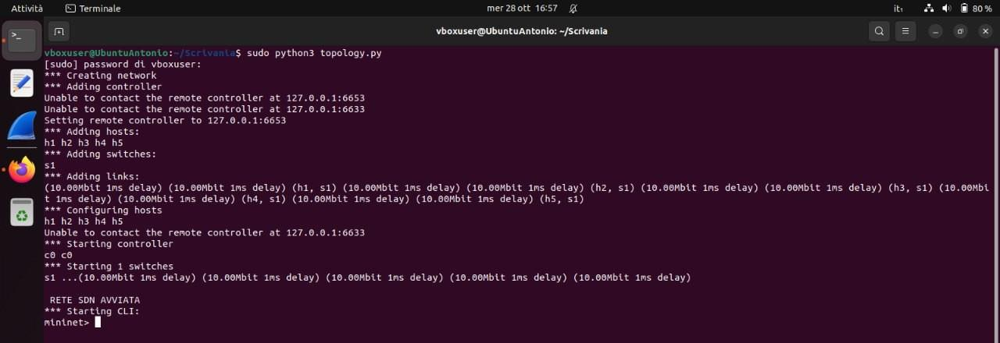

Questo comando genera la topologia di rete e inizializza la riga di comando di Mininet. Il secondo passo è la configurazione del controller Ryu. Senza controller la rete non può funzionare e anche i test fallirebbero poiché non esistono regole di inoltro preconfigurate.

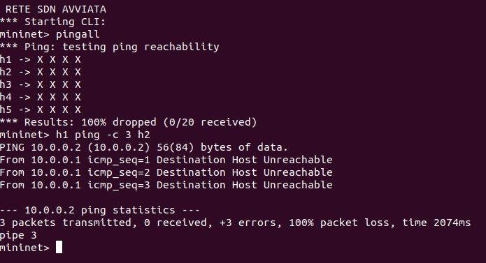

## 4. Installazione controller Ryu

Il secondo passo è l'avvio del controller Ryu, che avviene tramite il seguente comando:

```bash
ryu-manager Controller_RYU.py
```

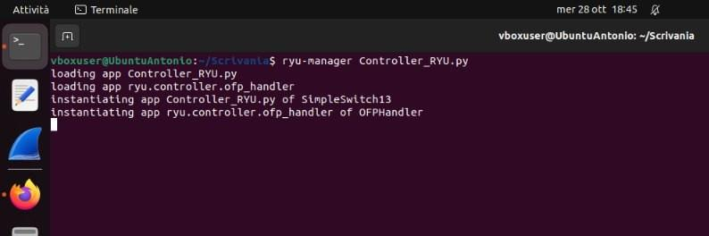

Una volta avviato il controller è possibile eseguire dei test per assicurarsi che tutto sia andato come si deve. Per farlo è necessario aprire un'altra finestra del terminale, eseguire lo script `topology.py` e dare uno dei comandi elencati sotto.

1. `pingall`
2. `h1 ping -c 3 h2`
3. `sh ovs-ofctl dump-flows s1 -O OpenFlow13`

- Il **primo** comando esegue un test di connessione tra tutte le possibili coppie di nodi presenti sulla rete; alla fine viene riportata la percentuale di packet loss, nel nostro caso 0% *dropped*.
- Il **secondo** comando verifica l'effettivo funzionamento del collegamento tra due host specificati, nel nostro esempio `h1` ed `h2`. Vengono inviati tre pacchetti ICMP Echo Request e vengono misurate la latenza e il packet loss.
- Il **terzo** interroga lo switch virtuale `s1` per stampare a schermo l'elenco delle regole di inoltro attualmente installate nelle sue tabelle, confermando che il controller Ryu sta gestendo correttamente il traffico tramite OpenFlow 1.3.

Esempio di test `pingall`:

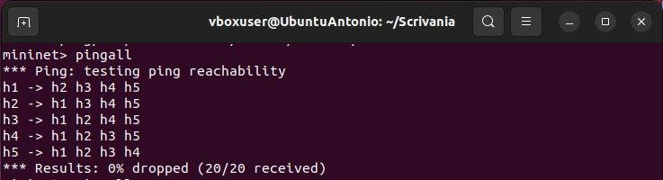

## 5. Script del controller Ryu

Lo script del controller Ryu è di fondamentale importanza per gli obiettivi progettuali, in quanto realizza una logica software-defined per il controllo centralizzato della rete a 360°. La grande forza delle reti SDN moderne è proprio quella di poter definire le policy di instradamento e sicurezza attraverso righe di codice, permettendo di validare architetture complesse in simulazione prima della loro messa in opera. Mentre lo script della topologia si limitava a creare l'infrastruttura fisica (host, link e switch), questo modulo implementa l'intelligenza necessaria affinché i nodi possano effettivamente comunicare. Nello specifico, lo script si occupa di apprendere dinamicamente i percorsi (MAC learning), gestire l'inoltro dei pacchetti e, come obiettivo cruciale, rilevare e mitigare proattivamente eventuali attacchi DoS.

Per l'implementazione del piano di controllo, il progetto prende come base di partenza l'applicazione ufficiale `simple_switch_13.py`, fornita nativamente dal framework Ryu. Questo script di base implementa le funzionalità standard di un *Learning Switch* di livello 2 compatibile con OpenFlow 1.3, occupandosi esclusivamente dell'apprendimento degli indirizzi MAC (MAC learning) e dell'inoltro basilare dei pacchetti.

Tuttavia, al fine di raggiungere gli obiettivi di sicurezza prefissati, il codice originale è stato esteso introducendo un modulo di difesa personalizzato. Nello specifico, è stata aggiunta una logica di monitoraggio del traffico IPv4 entrante per tracciare il numero di pacchetti per singolo IP sorgente, rilevare saturazioni anomale tipiche degli attacchi DoS e intervenire dinamicamente installando regole di blocco ad alta priorità sullo switch.

Analizziamo lo script suddividendolo in 5 parti:

1. Fase di Init e definizione delle strutture dati richieste
2. Gestione delle connessioni e regola di Table-Miss
3. `add_flow` per la modifica delle regole di inoltro
4. Intercettazione e Mitigazione
5. MAC Learning e inoltro

### 5.1 Fase di Init

In questa parte del codice si definiscono le strutture dati (dizionari) necessarie al controller per la gestione e il monitoraggio della rete. A differenza dello script originale, sono stati aggiunti il dizionario `self.packet_count` e la costante `self.DOS_THRESHOLD`. Quest'ultima serve a stabilire il limite massimo di pacchetti consecutivi consentiti da un singolo IP, oltre il quale scatterà il meccanismo di mitigazione che analizzeremo nella [sezione 5.4](#54-intercettazione-e-mitigazione).

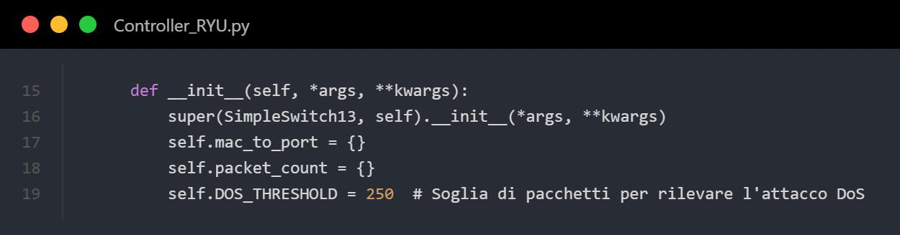

### 5.2 Fase di connessione e Table-Miss

In questa parte del codice si stabilisce il canale di comunicazione iniziale tra controller e switch. Quando lo switch si connette per la prima volta, il controller ne identifica le caratteristiche logiche (*datapath*) e installa immediatamente la regola di default detta **table-miss**. Tramite `self.add_flow` viene assegnata a questa regola la priorità minima assoluta (0) con un'istruzione ben precisa: tutto il traffico per cui lo switch non possiede ancora una regola di inoltro specifica non deve essere scartato, ma inoltrato direttamente al controller. In questo modo, qualsiasi pacchetto nuovo o sconosciuto viene passato al piano di controllo, permettendogli di analizzarlo a dovere.

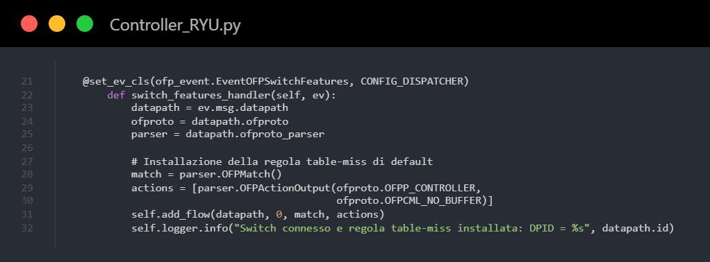

### 5.3 Funzione add_flow

In questo snippet si va a definire la funzione `add_flow()`, che serve al controller per programmare dinamicamente le tabelle di inoltro dello switch. Questa funzione è di importanza centrale nel progetto, in quanto serve sia per instradare il traffico lecito tra i client della rete, sia per iniettare istantaneamente la regola di blocco ad alta priorità per mitigare l'attacco DoS.

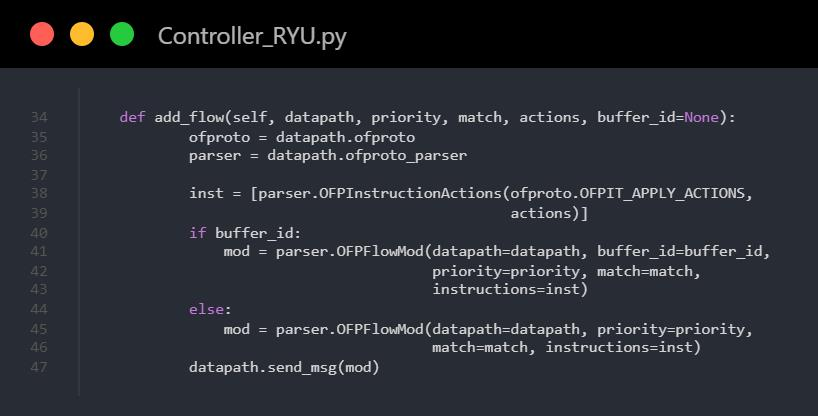

### 5.4 Intercettazione e Mitigazione

In questo snippet possiamo osservare la fase di monitoraggio ed eventuale mitigazione del traffico. Nella prima parte vengono estratte le informazioni utili per il monitoraggio e viene incrementato il contatore relativo ai pacchetti inviati dallo specifico IP. Dopodiché avviene il controllo della soglia critica impostata nello snippet della [sezione 5.1](#51-fase-di-init): se la soglia viene oltrepassata "scatta" l'allarme e l'attacco viene rilevato, e viene richiamata la funzione `add_flow()` alla quale viene detto di scartare tutti i pacchetti provenienti da uno specifico IP. Come si può vedere dai parametri di `add_flow()`, viene data la priorità **100** e una **lista di azioni vuota**: questa configurazione implica lo scarto automatico dei pacchetti.

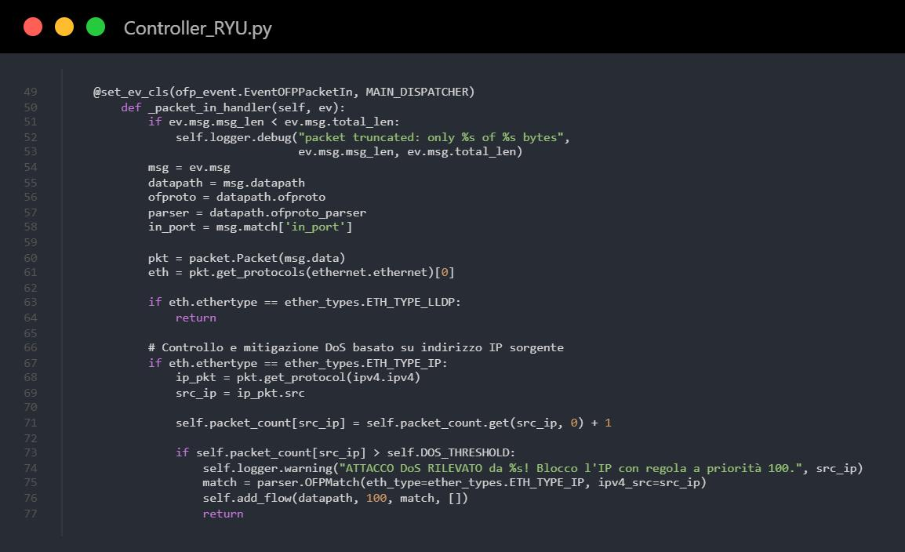

### 5.5 MAC Learning e inoltro legittimo

In questo ultimo snippet possiamo osservare l'implementazione delle funzionalità fondamentali di un Learning Switch, ovvero l'apprendimento degli indirizzi fisici e l'instradamento del traffico legittimo. Nella prima parte, il controller estrae l'indirizzo MAC sorgente del pacchetto in arrivo e ne memorizza la porta di provenienza aggiornando il dizionario `mac_to_port`. Successivamente, avviene la fase di decisione: il sistema verifica se l'indirizzo MAC di destinazione è già noto. Se la destinazione è presente in memoria, il controller imposta l'inoltro verso la porta specifica; in caso contrario, ordina allo switch di eseguire un'operazione di *flooding* (`OFPP_FLOOD`), inviando il pacchetto su tutte le porte per rintracciare il destinatario. Infine, se la porta di destinazione è nota, il controller richiama la funzione `add_flow()` per installare una regola di inoltro permanente con priorità 1.

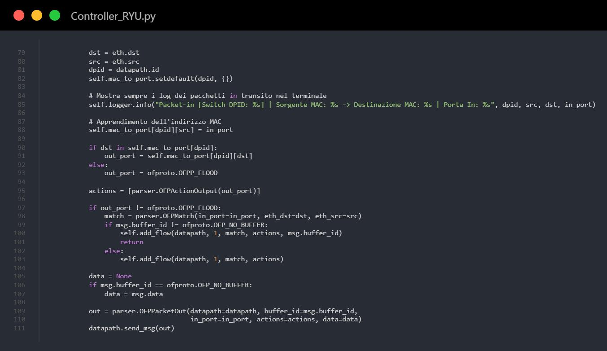

## 6. Simulazione attacco e mitigazione

### 6.1 Attacchi DoS

Nel contesto degli attacchi DoS citiamo due diverse modalità di attacco:

**1) Ping Flood** — È un attacco volumetrico che punta a saturare le risorse inondando il target di pacchetti ICMP Echo Request; il target risponde con una Echo Reply. È un attacco che punta a saturare rapidamente la banda e le capacità di calcolo del target.

```bash
h1 ping -f -c 1000 h2
```

**2) TCP SYN Flood** — È un attacco diverso. L'attaccante apre una grande quantità di richieste di connessione con il protocollo three-way handshake (SYN); il target risponde con una SYN-ACK e pre-alloca delle risorse per prepararsi a ricevere pacchetti dall'attaccante. Queste connessioni restano *pending*, saturando rapidamente le risorse del target.

```bash
h1 hping3 -S --flood 10.0.0.2
```

La differenza tra i due risiede nel livello della pila OSI in cui operano: il primo opera a livello 3 (rete), il secondo a livello 4 (trasporto). Il ping flood è un attacco di brute force che al giorno d'oggi viene subito rilevato e mitigato dai firewall; il secondo è più insidioso in quanto ha bisogno di una bassissima banda per essere messo in atto.

Il meccanismo di mitigazione del controller Ryu è in grado di mitigare entrambi gli attacchi. Nell'elaborato andremo a simulare un **TCP SYN Flood**.

### 6.2 Esecuzione del test

Per prima cosa bisogna avviare lo script `Topology.py` e il controller (`Controller_RYU.py`); una volta sulla shell di Mininet si digita il comando `h1 hping3 -S --flood 10.0.0.2` indicato nella sezione precedente.

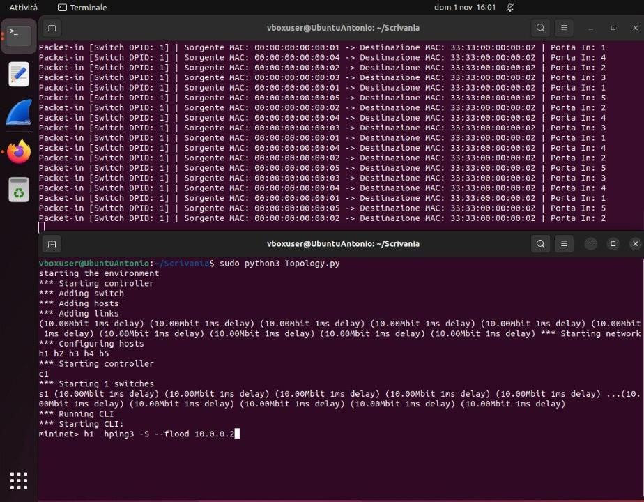

### 6.3 Rilevazione dell'attacco

Appena il nodo `h1` supera la soglia di allarme fissata a **250 pacchetti** l'attacco viene rilevato e segnalato. Subito dopo il nodo attaccante viene isolato dalla rete, l'attacco viene sventato e il traffico legittimo torna a funzionare correttamente, come è possibile vedere dai log del controller.

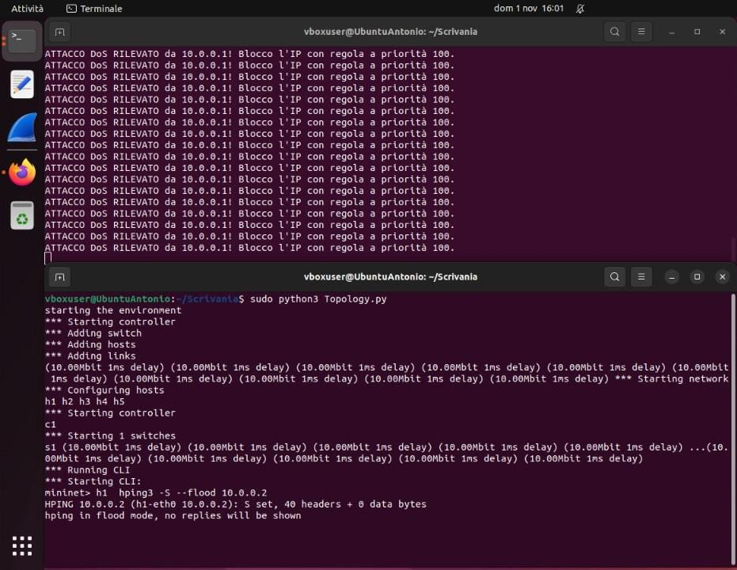

### 6.4 Isolamento dell'attaccante e ripresa del traffico

Nella prima shell si può vedere che il traffico legittimo è ripreso: in questo caso possiamo osservare i classici pacchetti inviati da un nodo all'altro così da costruire le tabelle di inoltro e aggiornare la topologia.

Nella seconda shell possiamo vedere che il nodo è stato correttamente isolato. Il test `pingall` mostra che `h1` non può raggiungere nessuno degli altri nodi e, viceversa, gli altri nodi non possono raggiungere `h1`. Al contempo il traffico tra i nodi `h2`, `h3`, `h4` ed `h5` procede regolarmente senza intoppi. Ciò dimostra che il meccanismo di mitigazione ha funzionato.

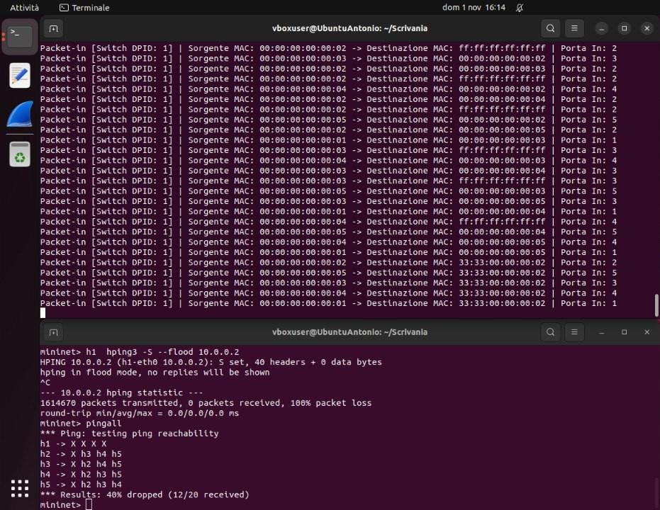

## 7. Limiti dell'implementazione e sviluppi futuri

Un aspetto critico emerso durante la fase di testing riguarda la logica di conteggio adottata per il rilevamento delle anomalie. Con questa implementazione, il controller Ryu monitora il traffico mantenendo un **contatore cumulativo assoluto** per ogni indirizzo IP sorgente. Di conseguenza, il normale traffico legittimo generato nel tempo da un host (come ripetuti test di diagnostica o sessioni di comunicazione prolungate) si somma all'interno della struttura dati.

Ciò comporta che, con lo scorrere delle normali comunicazioni, anche un nodo completamente benigno finirà inevitabilmente per superare la `DOS_THRESHOLD`. Quando ciò accade, il sistema interpreta il volume di traffico accumulato come un attacco in corso, innescando la regola di Drop a priorità 100 e causando un **falso positivo** che isola erroneamente l'host (fenomeno riscontrato in fase di simulazione durante esecuzioni ripetute del comando `pingall`).

Come principale sviluppo futuro per rendere il sistema idoneo a un ambiente di produzione, si prevede l'introduzione di un **timer per l'azzeramento periodico dei contatori**. Evolvere l'algoritmo di rilevamento per misurare una frequenza, ovvero il tasso di pacchetti al secondo (**PPS – Packets Per Second**), permetterà al controller di distinguere con precisione un picco anomalo e istantaneo, tipico di un attacco DoS volumetrico, dal normale flusso di traffico legittimo distribuito nel tempo.
