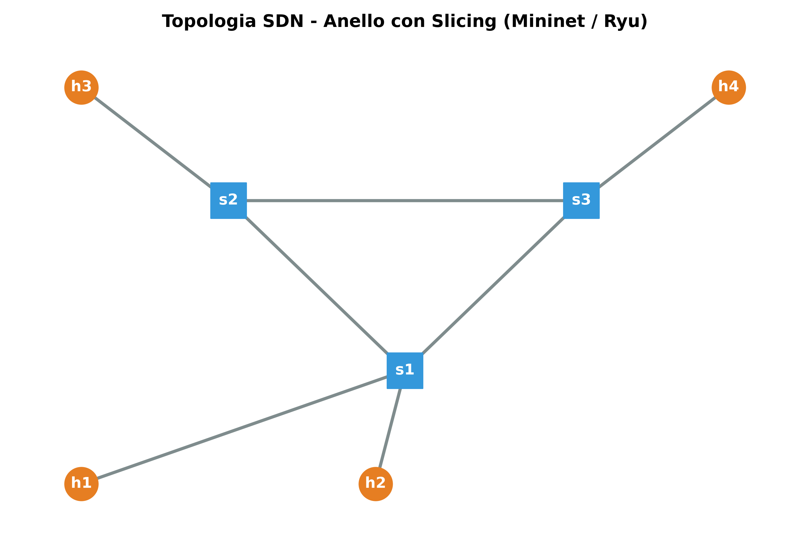

# SDN Network Slicing, DoS Mitigation & STP Resilience (Ryu + Mininet)

Esposito Luca - DE9000021  

Progetto che implementa, su una rete SDN emulata con **Mininet** e controllata da **Ryu**, un'architettura avanzata che integra tre pilastri fondamentali per le infrastrutture di rete moderne:
1. **Network e Service Slicing (QoS)**: Isolamento logico a livello hardware tra tenant differenti e gestione delle priorità dei flussi in base al protocollo (TCP/UDP, ICMP, traffico standard).
2. **Mitigazione Dinamica degli Attacchi DoS a Doppio Strato**: Rilevamento combinato (reattivo via *Packet-In* e statistico via *Flow Stats Request*) con meccanismo di **ban esponenziale** temporizzato.
3. **Resilienza e Convergenza STP (Spanning Tree Protocol)**: Gestione di topologie ad anello ridondante tramite il modulo `stplib` per prevenire loop di Layer 2 e garantire il failover automatico in caso di collasso dei link fisici.

---

## Indice

1. [Architettura Teorica e Moduli del Sistema](#1-architettura-teorica-e-moduli-del-sistema)
2. [Prerequisiti e Istruzioni di Esecuzione](#2-prerequisiti-e-istruzioni-di-esecuzione)
3. [Configurazione del Controller e Parametri](#3-configurazione-del-controller-e-parametri)
4. [Output dei Terminali e Risultati Sperimentali](#4-output-dei-terminali-e-risultati-sperimentali)
5. [Verifica delle Regole OpenFlow](#5-verifica-delle-regole-openflow)
6. [Troubleshooting](#6-troubleshooting)

---

## 1. Architettura Teorica e Moduli del Sistema



### 1.1 Topologia ad Anello e Isolamento Tenant (Slicing)
L'infrastruttura (`topology_slicing.py`) è composta da **3 Switch OpenFlow** (`s1`, `s2`, `s3`) interconnessi in una topologia ad anello ridondante e **4 Host** suddivisi in due slice isolate:
* **Tenant A (Slice A)**: `h1` (`10.0.0.1`) e `h3` (`10.0.0.3`)
* **Tenant B (Slice B)**: `h2` (`10.0.0.2`) e `h4` (`10.0.0.4`)

Il controller intercetta i pacchetti ARP e IPv4 in transito: qualsiasi tentativo di comunicazione *inter-tenant* (es. tra Slice A e Slice B) viene bloccato preventivamente installando una regola di drop hardware (`actions=[]`) ad alta priorità (`priority=80`). Il traffico legittimo *intra-tenant* viene invece classificato applicando politiche di **QoS**:
* **Priorità Alta (`50`)**: Flussi TCP/UDP
* **Priorità Media (`20`)**: Traffico diagnostico ICMP
* **Priorità Bassa (`10`)**: Traffico standard di default

### 1.2 Mitigazione DoS a Doppio Strato, Buffer Overflow e Ban Esponenziale
La protezione contro i flood di rete opera su due livelli complementari all'interno di `FinalSTPController`:
* **Livello 1 - Controllo Reattivo (`Packet-In`)**: Monitora in tempo reale il tasso di pacchetti generati da ciascun host sorgente in una finestra mobile (`TIME_WINDOW = 1.0s`). Superata la soglia (`RATE_LIMIT = 5`), scatta l'isolamento immediato.
* **Livello 2 - Monitoraggio Statistico Attivo (`_monitor`)**: Un thread dedicato interroga periodicamente il Data Plane degli switch tramite `OFPFlowStatsRequest` per intercettare anomalie volumetriche su flussi già installati.
* **Gestione delle Code e Tail Drop**: Durante attacchi intensi (es. 75 o 400 pacchetti ravvicinati), le code di trasmissione degli switch (*Transmission Queues*) saturano i buffer causando *tail drop*, mitigato istantaneamente dall'intervento della regola di scarto del controller.
* **Ban Esponenziale**: L'host malevolo viene isolato con una regola OpenFlow dotata di `hard_timeout` dinamico calcolato in base alla recidività dell'attacco: `Durata Ban = BASE_BAN_TIME * 2^(infrazioni - 1)` *(1ª infrazione = 15s di blocco, 2ª infrazione = 30s, ecc.)*

### 1.3 Resilienza di Livello 2 (Spanning Tree Protocol)
Per evitare broadcast storm sull'anello `s1-s2-s3`, il controller integra la libreria `stplib`, gestendo dinamicamente gli stati delle porte (`BLOCKING`, `LISTENING`, `LEARNING`, `FORWARDING`). In caso di rottura di un collegamento attivo, il protocollo rileva il cambio topologico e sblocca i link ridondanti portando la rete a convergenza.

---

## 2. Prerequisiti e Istruzioni di Esecuzione

### 2.1 Struttura della cartella

```text
.
├── README.md               # Documentazione tecnica e guida rapida di esecuzione
├── Relazione.pdf           # Relazione progettuale completa con analisi dei log
├── controller_slicing.py   # Controller Ryu: Slicing, QoS, Anti-DoS e STP
└── topology_slicing.py     # Script Mininet: topologia ad anello (3 switch, 4 host)

```

### 2.2 Istruzioni di esecuzione (Quickstart)

Aprire due finestre del terminale ed eseguire i seguenti comandi:

**1. Avviare il controller Ryu (Terminale 1):**

```bash
docker exec -it ambiente_sdn bash
pkill -9 -f ryu-manager
ryu-manager /workspace/controller_slicing.py

```

*(Lasciare questa finestra in attesa dopo l'avvio dell'app).*

**2. Entrare in Docker e pulire Mininet (Terminale 2):**
È fondamentale eseguire sempre il comando di pulizia prima di avviare la topologia, per svuotare le regole virtuali residue.

```bash
docker exec -it ambiente_sdn bash
mn -c

```

**3. Avviare la topologia in Mininet (Terminale 2):**

```bash
mn --custom /workspace/topology_slicing.py --topo slicingtopo --switch ovs,datapath=user --controller=remote,ip=127.0.0.1,port=6633 --mac

```

*(Attenzione: attendere circa 10-15 secondi che i log dell'STP nel Terminale 1 si stabilizzino e terminino prima di lanciare i comandi di test).*

**4. Eseguire i test di validazione dalla CLI di Mininet (Terminale 2):**

* **Test di Connettività Base e Slicing (Tenant A vs Tenant B - Bloccato al 100%)**:

```text
mininet> pingall
mininet> h1 ping -c 6 -i 0.1 h4

```

*(Nel pingall alcuni host risulteranno irraggiungibili (X) per via dell'isolamento. Il ping h1-h4 darà Destination Host Unreachable).*

* **Test di Confine e Flood DoS (Attivazione Ban Esponenziale 15s -> 30s)**:
Osservare il Terminale 1 mentre si lancia l'attacco.

```text
mininet> h1 ping -c 400 -i 0.1 h3

```

*(Nel Terminale 1 appariranno i log di blocco per Infrazione #1).*

* **Test di Resilienza STP e Failover (Simulazione rottura e ripristino link fisico)**:

```text
mininet> link s1 s2 down
mininet> pingall

```

*(Il traffico continuerà a scorrere attraverso il percorso di riserva su s3 abilitato dall'STP).*

---

## 3. Configurazione del Controller e Parametri

I parametri operativi principali sono definiti all'interno della classe `FinalSTPController` in `controller_slicing.py`:

| Parametro / Costante | Valore | Descrizione |
| --- | --- | --- |
| `Slice A` / `Slice B` | `{h1, h3}` / `{h2, h4}` | Raggruppamento logico dei tenant autorizzati a comunicare |
| `Priority Slicing Drop` | `80` | Priorità della regola di blocco tra slice differenti |
| `Priority QoS` | `50` / `20` / `10` | Priorità assegnate rispettivamente a TCP-UDP / ICMP / Default |
| `TIME_WINDOW` | `1.0` s | Finestra temporale per il calcolo del rate sul Packet-In |
| `RATE_LIMIT` | `5` pkt | Soglia massima di pacchetti consentiti nella finestra temporale |
| `BASE_BAN_TIME` | `15` s | Durata base del blocco DoS (raddoppia a ogni infrazione successiva) |

---

## 4. Output dei Terminali e Risultati Sperimentali

* **Isolamento Slicing**: Il test `h1 ping -c 6 -i 0.1 h4` restituisce `100% packet loss (Destination Host Unreachable)`, accompagnato sul controller dal log `[SLICING] Traffico bloccato tra tenant: 10.0.0.1 -> 10.0.0.4`.
* **Mitigazione Flood DoS**: I test a raffica (`-c 75` e `-c 400` con intervallo `0.1s`) vengono abbattuti con una perdita del **90.6%** e **97.5%** dei pacchetti malevoli, generando i log di sicurezza:
* `>>> [DOS DA PACKET_IN] Host 00:00:00:00:00:01 bloccato per 15s! (Infrazione #1) <<<`
* `>>> [DOS DA STATISTICHE] Host 00:00:00:00:00:01 bloccato per 30s! (Infrazione #2) <<<`


* **Convergenza STP**: Alla caduta del link `s1-s2`, il controller rileva `[STP][INFO] Link down` e ricalcola dinamicamente l'albero di copertura (`Cambio topologia rilevato! Ricalcolo i percorsi...`), instradando il traffico sul ramo alternativo senza interrompere la sessione di ping.

---

## 5. Verifica delle Regole OpenFlow

Per ispezionare in tempo reale la Flow Table installata dal controller sullo switch `s1` (verificando i contatori dei pacchetti, i drop di slicing a priorità `80` e le regole QoS a priorità `20` e `10`):

```bash
ovs-ofctl dump-flows s1

```

---

## 6. Troubleshooting

* **Pulizia dell'ambiente Mininet** in caso di topologie bloccate o sessioni precedenti interrotte:

```bash
mn -c

```

* **Connessione Controller-Switch**: Avviare sempre il controller Ryu *prima* di lanciare il comando `mn` e assicurarsi che la porta specificata (`6633`) coincida con quella in ascolto sul controller.
